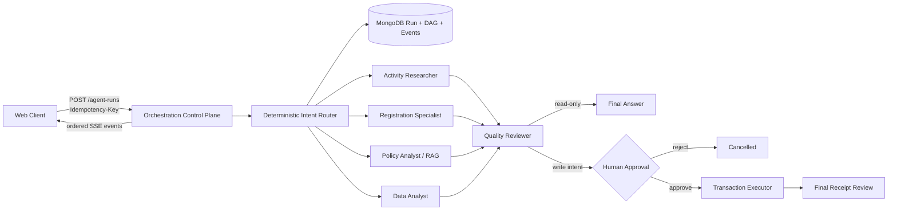
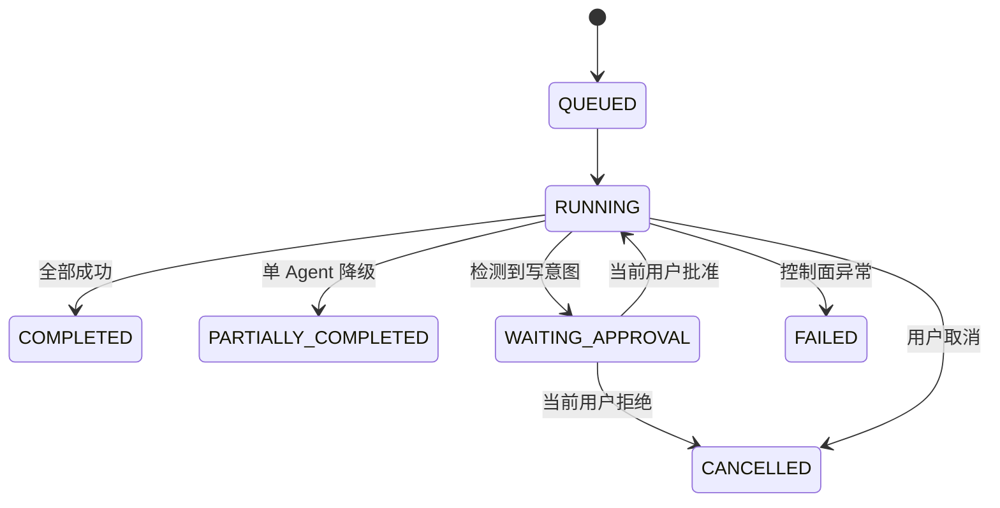

# CampusClub 多 Agent 编排架构

## 1. 目标与边界

CampusClub 的多 Agent 设计解决三类问题：复杂咨询需要跨领域取证；实时数据和政策知识来源不同；报名写操作必须可控、可审计。系统采用“确定性控制面 + LLM 数据面”，不允许模型自行决定权限、审批或运行状态。

当前实现适合单服务实例的完整作品集与中等流量部署。若需要多实例水平扩展，应把本地虚拟线程任务队列替换为 Kafka/RabbitMQ/Temporal，并为运行增加分布式租约；领域接口与持久化状态模型可以保持不变。

## 2. 请求链路

关键点：专职 Agent 在同一层并行；Reviewer 依赖全部专职任务，是显式 DAG 节点。事务 Agent 在审批之前不存在，因此无法通过提示词注入提前获得写工具。

## 3. 角色与权限

| 角色 | 数据源 / 工具 | 可写 |
|------|---------------|------|
| Activity Researcher | 活动搜索、近期活动、社团活动、票码查询 | 否 |
| Registration Specialist | 本人报名、报名详情 | 否 |
| Policy Analyst | Redis Vector Store + QuestionAnswerAdvisor | 否 |
| Data Analyst | 活动统计、管理员仪表盘（仍受 RBAC） | 否 |
| Campus Guide | 模型常识，仅做能力导航 | 否 |
| Transaction Executor | 活动/报名读取 + 创建/取消报名 | 是，仅审批后 |
| Quality Reviewer | 上游证据 | 否 |

身份从 JWT 解析后固化到运行上下文，通过 `AiRequestContext` 绑定到每个虚拟线程。模型不能通过用户参数替换 `userId`。Reviewer 把上游内容视为不可信证据，忽略其中的越权指令，降低跨 Agent prompt injection 风险。

## 4. 状态机与审批

审批由服务端状态机校验，只有运行所有者可操作。事务 Agent 最多尝试一次：若模型调用写工具后网络超时，自动重试可能造成重复副作用，因此系统返回降级结果并要求核对。服务重启遇到 `RUNNING` 的事务任务时也不会自动重放。

## 5. 一致性与幂等

- 客户端用 `Idempotency-Key` 创建运行；MongoDB 对 `(user_id, idempotency_key)` 建唯一复合索引。
- 每个运行维护单调递增 `event.sequence`；SSE 支持 `after` / `Last-Event-ID`，前端按序去重。
- MySQL `registration.active_guard` 是生成列，唯一索引保证同一用户和活动最多一条有效报名，覆盖并发请求竞争。
- 取消报名使用 `id + status=1` 条件更新；只有抢到状态迁移的请求才释放容量，避免双重返还。
- 读任务可安全重试与重启恢复；结果不确定的写任务进入人工核对路径。

## 6. 弹性策略

| 故障 | 策略 | 运行结果 |
|------|------|----------|
| 单个只读 Agent 模型失败 | 有限重试，累计失败触发按角色熔断 | Reviewer 使用剩余证据，`PARTIALLY_COMPLETED` |
| 单个 Agent 超时 | 取消等待，不阻塞其他并行任务 | 降级完成或失败 |
| Reviewer 失败 | 直接拼接最多三份成功证据 | 降级完成 |
| 用户拒绝审批 | 不创建事务调用 | `CANCELLED` |
| 服务在只读阶段重启 | 重置未完成任务并安全重放 | 继续运行 |
| 服务在事务调用中重启 | 禁止自动重放，提示人工核对 | `FAILED` + reconciliation event |

配置位于 `app.agent.*`：`task-timeout-seconds`、`max-attempts`、`max-run-events`、`circuit-breaker-threshold`、`circuit-breaker-open-seconds`。

## 7. 可观测性与建议 SLO

三层信号可以通过同一个 `runId` 关联：

- 用户层：SSE 显示任务开始、完成、失败、审批和最终答复。
- 审计层：MongoDB 保存角色、依赖、尝试次数、耗时、审批人与事件序列。
- 指标层：Micrometer `campusclub.agent.runs{event}` 与 `campusclub.agent.task.duration{role,status}`。

建议初始 SLO：只读运行可用性 99.9%；不含模型生成耗时的编排控制面 P95 小于 200 ms；简单查询端到端 P95 小于 15 s；写操作审批后 100% 产生可追踪的事务回执或核对事件。生产环境应基于真实模型延迟重新校准。

## 8. 测试策略

- `IntentRouterTest`：跨域路由、只读/写意图区分、快速路径。
- `AgentOrchestrationServiceTest`：并行任务 + Reviewer 完成、写操作等待审批、审批后事务任务创建。
- 既有业务测试：认证上下文、报名工具、并发相关领域行为。
- 前端执行 `npm run build` 验证 Agent 轨迹与审批交互可以生产打包。

生产进一步建议：增加 Testcontainers 集成测试、模型契约录制回放、基于恶意提示集的越权评测、OpenTelemetry trace export，以及用消息队列/工作流引擎实现多实例任务租约。

## 9. 面试可讲的设计取舍

1. 为什么控制面不用 LLM planner：权限和状态迁移需要确定性、可测试和可审计；模型只负责语义任务。
2. 为什么不是所有角色都能调用全部工具：最小权限降低误调用与 prompt injection 的爆炸半径。
3. 为什么写 Agent 不重试：读取是 at-least-once 友好的，外部副作用在结果不确定时必须先保证安全。
4. 为什么选 MongoDB 保存运行：任务和事件是嵌套、演进快的聚合；强事务业务数据仍留在 MySQL。
5. 如何演进到多实例：保持 `AgentWorker` 接口，执行器替换为消息队列或 Temporal，并增加 lease/heartbeat，不侵入领域工具。
